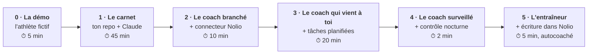
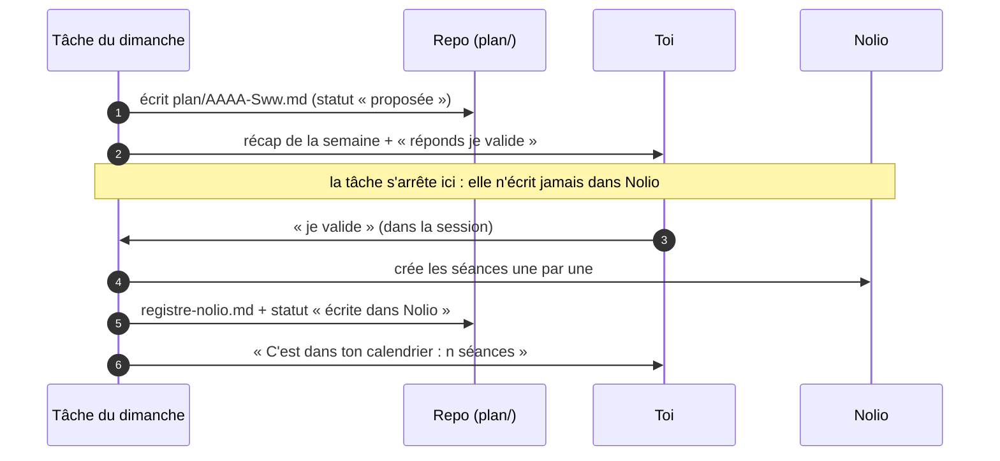

# Automatisation — du carnet au coach qui écrit ton plan

> **À quoi sert ce fichier :** les 6 niveaux d'automatisation du coach, et comment installer chacun, pas à pas. Tu peux t'arrêter à n'importe quel niveau : chacun est utile seul.
> **Mis à jour par :** contenu du projet.



| Niveau | Tu ajoutes | Tu obtiens | Pour qui |
|---|---|---|---|
| **0 · La démo** | rien | le coach qui tourne sur un athlète fictif | les curieux, avant de se lancer |
| **1 · Le carnet** | ton repo, une session Claude | un profil, des objectifs SMART, un débrief de course, le tri d'une douleur, en conversation | tout le monde, même sans Nolio |
| **2 · Le coach branché** | le connecteur Nolio | « fais mon brief », « débriefe ma journée » : tes vraies données, à la demande | les utilisateurs de Nolio (compte payant) |
| **3 · Le coach qui vient à toi** | 4 tâches planifiées, la météo | un brief chaque matin, un débrief chaque soir, un bilan chaque semaine et chaque mois | ceux qui veulent un suivi quotidien |
| **4 · Le coach surveillé** | la GitHub Action (déjà dans le repo) | un mail si une tâche ne tourne pas ; un coach qui s'améliore avec tes retours | ceux qui ne veulent pas vérifier |
| **5 · L'entraîneur** | la permission de création dans Nolio | il propose ta semaine et l'écrit dans Nolio quand tu dis « je valide » | mode autocoaché seulement |

---

## Ce qu'il te faut

- Un compte **GitHub** (gratuit).
- Un abonnement **Claude** Pro ou Max : les tâches planifiées et les sessions sur un repo en ont besoin.
- Pour les niveaux 2 et plus : un compte **Nolio payant** (Premium Athlete, ou un compte coach). Un athlète coaché sur un compte gratuit n'a pas accès au connecteur : il lui faut Premium Athlete. Voir `docs/nolio.md`.

## Niveau 0 — La démo (5 min)

Pour voir le coach tourner avant de remplir quoi que ce soit.

1. Crée ton repo depuis le template (étape 1 du niveau 1).
2. Dans `reglages.md`, remplace `plateforme: nolio` par `plateforme: demo` (sur GitHub : le crayon ✏️, puis « Commit changes »).
3. Ouvre une session Claude sur ton repo (étape 3 du niveau 1) et dis : « Fais mon brief du matin ».
4. Le coach lit l'athlète fictif (`examples/athlete-fictif/`) et ses données simulées, sans rien écrire.
5. Essaie aussi « Fais mon débrief du soir », « Fais le bilan de la semaine », « Prépare ma semaine prochaine ».

Remets `plateforme: nolio` avant de passer au niveau 1.

## Niveau 1 — Le carnet (45 min)

1. **Crée ton repo** : sur la page GitHub du projet, clique sur **Use this template** → **Create a new repository**. Choisis un nom, coche **Private** (c'est obligatoire : le repo contiendra des données de santé), puis **Create repository**.
2. **Connecte GitHub à Claude** (une fois) : va sur [claude.ai/code](https://claude.ai/code). La première fois, Claude te propose de connecter ton compte GitHub : accepte, puis, quand GitHub te demande à quels repos Claude a accès, choisis :
   - **All repositories** : Claude voit tous tes repos, présents et futurs ;
   - ou **Only select repositories** : coche ton repo coach. C'est plus prudent, mais il faudra cocher aussi chaque nouveau repo.

   Déjà connecté, mais ton repo n'apparaît pas ? Sur GitHub : ta photo → **Settings** → **Applications** → **Installed GitHub Apps** → **Claude** → **Configure** → **Repository access**. Ajoute ton repo, puis **Save**.
3. **Ouvre une session sur ton repo** : sur claude.ai/code (ou dans l'onglet Code de l'app Claude, sur ordinateur ou téléphone), choisis ton repo dans la liste et démarre une session. Elle part toujours de la branche `main` de ton repo.
4. **Lance l'onboarding** : dis « Lance l'onboarding ». C'est une interview, une question à la fois (`conversations/onboarding.md`). Tu peux couper : la fois suivante, le coach reprend là où vous en étiez.

À ce niveau, tu parles à ton coach quand tu veux : « Débriefe ma course » (`conversations/debrief-course.md`), « J'ai mal au genou » (`conversations/alerte-douleur.md`), « Mets à jour mon profil ».

## Niveau 2 — Le coach branché (10 min)

1. **Ajoute le connecteur Nolio** : dans Claude, **Réglages → Connecteurs**, puis ajoute Nolio depuis l'annuaire, ou en connecteur personnalisé avec l'adresse `https://mcp.nolio.io/mcp`.
2. **Choisis les permissions** à la connexion Nolio :
   - mode avec coach : **lecture** seulement ;
   - mode autocoaché : **lecture** pour l'instant, la création viendra au niveau 5.
3. **Vérifie** : dans une session, dis « Quelles sont mes 3 dernières séances dans Nolio ? ».

Tu peux maintenant tout lancer à la main : « Fais mon brief », « Fais mon débrief », « Fais le bilan de la semaine ». Le coach suit le même fichier `automations/` que la tâche planifiée.

## Niveau 3 — Le coach qui vient à toi (20 min)

### 3.1 Autoriser la météo (une fois)

L'environnement cloud de Claude bloque par défaut les sites hors d'une liste. Ajoute la météo en suivant `docs/open-meteo.md`, soit 3 domaines : `api.open-meteo.com`, `geocoding-api.open-meteo.com` et `api.met.no` (le secours).

### 3.2 Créer les 4 tâches planifiées

Dans Claude : onglet **Code** → **Planifiées** (ou [claude.ai/code/routines](https://claude.ai/code/routines)) → **Nouvelle tâche**. Le nom de l'écran peut varier selon les versions : « tâches planifiées », « routines », « automatisations ».

Pour chaque tâche du tableau :
- **Nom** : celui du tableau.
- **Prompt** : le prompt « talon » ci-dessous, en changeant seulement le nom du fichier.
- **Repo** : ton repo coach. C'est ce qui permet au coach d'écrire son journal.
- **Environnement** : celui où tu as autorisé la météo.
- **Connecteurs** : garde seulement ceux du tableau et décoche les autres (moins d'outils, c'est moins de tokens et moins de risques).
- **Fréquence et heure** : celles du tableau, ajustées à ta vie.
- **Modèle** : celui du tableau.

| Nom | Fichier | Quand | Connecteurs | Modèle |
|---|---|---|---|---|
| Coach — brief du matin | `automations/brief-matin.md` | tous les jours, 07:37 | Nolio, (Google Agenda) | rapide (Sonnet) |
| Coach — débrief du soir | `automations/debrief-soir.md` | tous les jours, 21:07 | Nolio, (Google Agenda) | rapide (Sonnet) |
| Coach — bilan hebdo | `automations/bilan-hebdo.md` | le dimanche, 21:37 | Nolio | capable (Opus) |
| Coach — bilan mensuel | `automations/bilan-mensuel.md` | le 1er du mois, 19:07 | Nolio | capable (Opus) |

Pourquoi « :07 » et « :37 » ? Les tâches lancées pile à l'heure démarrent parfois avec quelques minutes de retard. Et le brief tombe environ 1 h après ton réveil, le temps que ta montre synchronise ta nuit.

**Le prompt talon** (le même pour les 4, seul le fichier change) :

```text
Lis CLAUDE.md, puis exécute le prompt du fichier automations/brief-matin.md (tout ce qui suit la ligne ---).
Date du jour : aujourd'hui, dans le fuseau de reglages.md.
C'est une tâche planifiée : n'écris jamais dans Nolio pendant cette exécution.
Termine par un commit et un push sur main.
```

Pourquoi un talon ? Toute la logique vit dans le repo. Pour changer ton brief, tu modifies `automations/brief-matin.md` (ou tu demandes au coach de le faire), sans revenir dans les réglages de Claude.

### 3.3 Tester

Sur la page de chaque tâche, clique sur **Exécuter maintenant** (« Run now »). Puis vérifie :
- la session de la tâche affiche le message (brief, débrief…) ;
- une ligne est apparue à la fin de `automations/runs.md`, avec `ok` ;
- pour le débrief, la note du jour existe dans `journal/AAAA/`.

### 3.4 Au quotidien

- **Lire** : chaque exécution est une session dans l'onglet Code de l'app Claude, sur téléphone ou sur ordinateur.
- **Répondre** : les questions du débrief se répondent dans cette session, en vrac, quand tu veux dans la soirée. Le coach complète ta note du jour.
- **Ajuster une heure** : modifie la tâche dans Claude, pas le repo (mets à jour le mémo de `reglages.md` si tu veux).

## Niveau 4 — Le coach surveillé (2 min)

Deux mécanismes, déjà dans le repo.

**Le contrôle nocturne.** Chaque tâche ajoute une ligne à `automations/runs.md`. Chaque nuit, la GitHub Action « Contrôle du coach » (`.github/workflows/controle.yml`) lance `scripts/controle.py`. Si une tâche n'a pas tourné, a échoué, ou si un lien du repo est cassé, le contrôle échoue et **GitHub t'envoie un mail**.
1. Dans ton repo GitHub, onglet **Actions** : si GitHub le demande, clique sur « I understand my workflows, go ahead and enable them ».
2. Clique sur **Contrôle du coach** → **Run workflow** pour un premier essai.
3. Vérifie que les notifications d'Actions sont actives dans tes réglages GitHub (Settings → Notifications → Actions).

**La boucle d'amélioration.** Chaque tâche finit par une question pour mieux faire son travail (« Trop long ce matin ? »). Tes réponses vont dans `profil/retours-agent.md`, et le coach ajuste son propre prompt dans `automations/` quand tu valides le changement. Le bilan mensuel fait le ménage pour que ce fichier reste court.

## Niveau 5 — L'entraîneur (5 min, mode autocoaché)

Le coach propose ta semaine et l'écrit dans ton calendrier Nolio, **seulement après ton « je valide »**.

1. **Permissions Nolio** : déconnecte puis reconnecte le connecteur Nolio dans Claude, et coche **lecture + création + suppression**. Ne coche jamais **modification** : Nolio peut annuler une création ou une suppression, pas une modification. Pour changer une séance, le coach la supprime et la recrée.
2. Dans `reglages.md` : `permissions_nolio: lecture+creation+suppression`.
3. **Essaie** : « Prépare ma semaine prochaine » (`conversations/planifier.md`). Lis le récap, réponds « je valide », puis vérifie dans Nolio et dans `plan/registre-nolio.md`.

Le dimanche, le bilan hebdo propose la semaine suivante. Tu ouvres sa session et tu réponds « je valide » (ou ce que tu veux changer). Une tâche planifiée ne peut jamais écrire dans Nolio d'elle-même : c'est ta réponse qui vaut accord.



---

## Coût et consommation : rester léger

Les tâches planifiées consomment ton abonnement Claude, comme une conversation. Compte environ 65 exécutions par mois (30 briefs, 30 débriefs, 4 ou 5 bilans hebdo, 1 bilan mensuel).
Ce qui garde le coach léger, et que le projet fait déjà :
- **Un talon de 4 lignes** dans la tâche : le prompt détaillé est lu dans le repo.
- **Une mémoire courte** : le brief ne lit que `etat.md` (40 lignes), jamais le journal. Son coût ne grossit pas avec les mois.
- **Des lectures ciblées** : le débrief lit la note d'hier, l'hebdo les 7 notes de la semaine, le mensuel les bilans hebdo. Personne ne relit tout.
- **Des modules conditionnels** : le mode course, le voyage, la reprise ne sont lus que quand c'est utile.
- **Peu de connecteurs** : chaque connecteur coché ajoute ses outils au contexte. Décoche tout ce qui ne sert pas.
- **Le bon modèle** : un modèle rapide pour le quotidien, le plus capable pour les bilans et les conversations.

Après une semaine, regarde ta consommation dans Claude (**Réglages → Utilisation**). Si c'est trop, garde le brief et le bilan hebdo, et lance le débrief à la main les jours de séance.

## Alternative : les tâches planifiées de l'app de bureau

L'app Claude pour ordinateur sait aussi planifier des tâches qui tournent **sur ton ordinateur** (il doit être allumé), sur une copie locale du repo. C'est utile si tu ne veux pas de cloud, mais c'est moins pratique : pas de brief si l'ordinateur dort. Le contenu des fichiers `automations/` ne change pas.

## Quand ça coince

| Symptôme | Cause probable | Que faire |
|---|---|---|
| Mon repo n'apparaît pas dans Claude | Claude n'a pas accès à ce repo sur GitHub | GitHub → Settings → Applications → Claude → Configure → ajoute le repo (niveau 1, étape 2) |
| Pas de météo, ou « host_not_allowed » | domaine non autorisé | `docs/open-meteo.md` |
| Météo « quota » ou 429 | Open-Meteo saturé | rien : le secours met.no prend le relais |
| « Je n'ai pas accès à Nolio » | connecteur décoché dans la tâche, ou expiré | coche Nolio dans la tâche ; reconnecte-le dans Réglages → Connecteurs |
| Le journal n'arrive pas sur `main` | push sur une branche `claude/…` | vérifie que le talon dit bien « push sur main » |
| Mail « Contrôle du coach » en échec | une tâche n'a pas tourné, ou un lien est cassé | ouvre le mail : le rapport dit quoi |
| Le brief est vide de forme | montre pas encore synchronisée | décale le brief plus tard |
| Le coach refuse d'écrire dans Nolio | mode avec coach, ou tâche planifiée, ou permission absente | c'est voulu : voir le niveau 5 |
