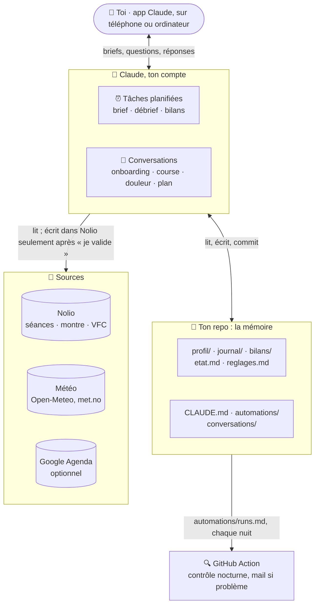
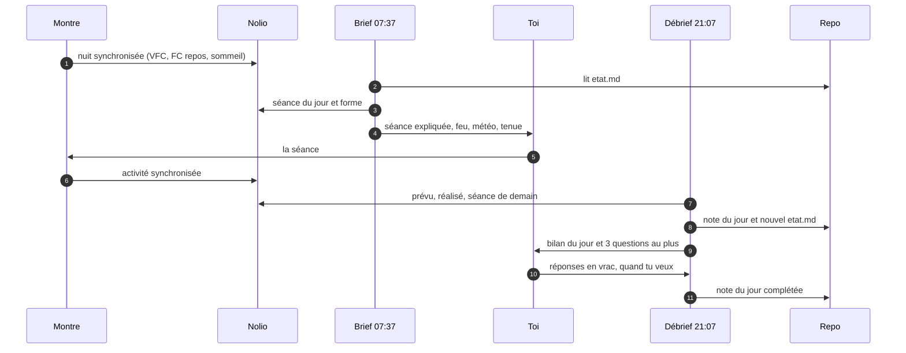
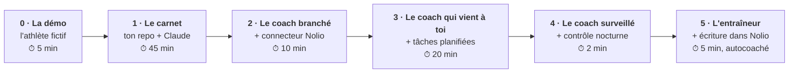
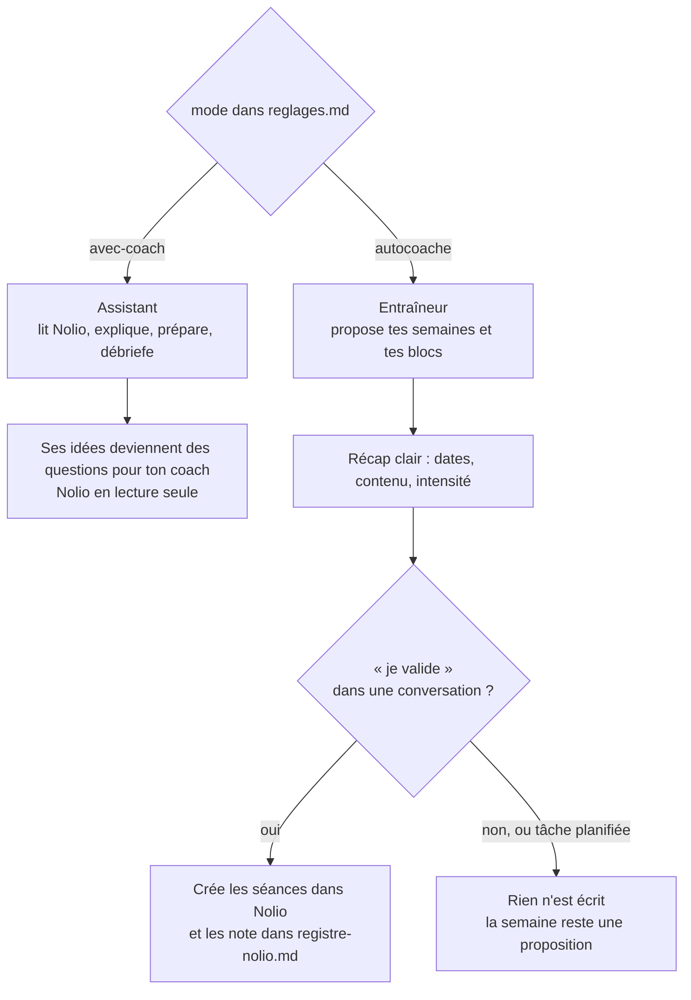

# 🏃 Coach running & trail · Claude × Nolio

> **À quoi sert ce fichier :** présenter le projet, montrer ce qu'il fait, et t'emmener de zéro à ton premier brief du matin.
> **Mis à jour par :** contenu du projet.

**Un coach personnel de course à pied et de trail, propulsé par Claude et branché sur ta plateforme d'entraînement Nolio.**
Il t'explique ta séance du jour, lit ta forme du matin, débriefe ta journée, fait tes bilans et prépare tes courses. En mode autocoaché, il écrit même ton plan, mais seulement quand tu dis « je valide ».

**Zéro code, zéro installation** : un dossier de fichiers texte sur GitHub (la mémoire), Claude (le cerveau) et des tâches planifiées (le rythme). Si tu sais utiliser claude.ai et créer un compte GitHub, tu sais l'installer.

    

Tu es coach et tu veux un assistant pour suivre tes athlètes ? C'est le projet jumeau : [`running-coach-coaches-template`](https://github.com/VitoPepe/running-coach-coaches-template).

> ⚠️ **Ton coach n'est pas médecin.** Douleur qui dure, douleur dans la poitrine, malaise, blessure : il te dit d'arrêter et de consulter, sans nuance. Voir [Sécurité](#-sécurité).

---

## Sommaire

- [Ce que fait ton coach](#-ce-que-fait-ton-coach)
- [Comment ça marche](#-comment-ça-marche)
- [Les 6 niveaux d'automatisation](#-les-6-niveaux-dautomatisation)
- [Démarrer](#-démarrer)
- [Les deux modes](#-les-deux-modes)
- [Les automatisations et les conversations](#-les-automatisations-et-les-conversations)
- [Ce qu'il y a dans le repo](#-ce-quil-y-a-dans-le-repo)
- [Sécurité](#-sécurité) · [Confidentialité](#-confidentialité) · [Coût](#-coût-et-consommation) · [Limites](#-limites)
- [FAQ](#-faq) · [Documentation](#-documentation) · [Contribuer](#-contribuer)

---

## ✨ Ce que fait ton coach

| Quand | Quoi |
|---|---|
| ☀️ **Chaque matin** | ta séance expliquée simplement (but, contenu, allures et zones, conseil), ta forme du jour 🟢🟠🔴 (VFC, FC repos, sommeil), la météo et la tenue, une ligne carburant si la séance compte. Un jour de repos ? Il le dit, et propose 10 min de mobilité. |
| 🌙 **Chaque soir** | le prévu comparé au réalisé, 3 questions au plus (ressenti, RPE, douleur), la note du jour dans ton journal, une alerte si besoin, et la préparation de demain. |
| 📊 **Chaque dimanche** | volume, intensité, D+, respect du plan, tendances de forme, 3 points positifs, 1 point à travailler, le cap SMART de la semaine suivante. |
| 🗓️ **Chaque 1er du mois** | la progression vers tes objectifs, les tendances sur 4 semaines, les records, l'usure des chaussures, une lecture conseillée. |
| 🏁 **Autour d'une course** | la semaine de course de J-7 à J-1 (affûtage, sommeil, plan de course, ravitos, sac), la timeline du jour J, puis un débrief guidé avec les 5 pourquoi et un récap à partager. |
| 💬 **Quand tu veux** | « J'ai mal au genou » (tri et drapeaux rouges), « Prépare ma semaine » (autocoaché), « Je pars à Lyon jeudi » (mode voyage). |

### Un brief du matin

> **☀️ Lundi 19 octobre**  
> 🔋 Forme : 🟠 · VFC 7 j 57 ms (norme 52–64) · FC repos 53 (moy. 49) · sommeil 7 h 05 → ta FC repos est 4 bpm au-dessus de ta moyenne après ton gros week-end : je te propose une version allégée.  
> 🏃 Séance : Footing facile + 6 lignes droites — 45 min · créneau conseillé : 18 h 15, pour rentrer avant la nuit (18 h 45)  
>    Version allégée : 30 min très faciles, sans les lignes droites. Rien n'est changé dans Nolio : c'est toi qui choisis.  
>    But : faire tourner les jambes après tes 3 h 43 de course du week-end, sans ajouter de fatigue.  
>    Contenu : 30 min en continu sur le plat (les quais) · pas d'échauffement à part · 2 min de marche pour finir.  
>    Repères : Z1, FC sous 135, RPE 2 : tu dois pouvoir parler en phrases complètes.  
>    Conseil : si les jambes restent lourdes après 10 min, rentre : le repos fait aussi partie de l'entraînement.  
> 🌦️ Météo : 12 °C à 18 h (ressenti 11 °C), pluie 40 % puis 55 % à 19 h, vent faible → tenue : short ou corsaire, manches longues fines ; veste légère et frontale si tu pars après 19 h.  
> 🔧 Pour m'améliorer : le détail du feu orange t'aide, ou une ligne te suffit ?

### Un débrief du soir

> **🌙 Débrief du dimanche 18 octobre**  
> 🏃 Séance : prévu footing vallonné 1 h 10 / réalisé 1 h 11, 11,2 km, 150 m D+ → conforme : FC moyenne 137, 67 min sur 71 en zone basse.  
> 💬 Ce que j'en retiens : 3 h 43 de course ce week-end et des jambes juste un peu lourdes : ta sortie longue d'hier est bien digérée.  
> 📅 Demain : rien dans Nolio pour l'instant, ta semaine prochaine arrive avec le bilan de 21 h 37 — le lundi reste court ou repos.  
> ❓ Réponds ici quand tu veux ce soir, en vrac :  
>    1. Ressenti général de la journée, de 1 à 5 ?  
> 🔧 Pour m'améliorer : le prévu/réalisé en une ligne te suffit, ou tu veux aussi le détail des zones ?

*Exemples écrits à partir des données de démo de [Nora, l'athlète fictive](examples/athlete-fictif/README.md) du projet. Toutes ses données sont inventées.*

---

## 🧠 Comment ça marche

Trois briques :
- **Claude** est le cerveau qui exécute.
- **Ton repo GitHub privé** est la mémoire, en fichiers texte : profil, objectifs, journal, bilans.
- **Les connecteurs** apportent les données : Nolio pour les séances, la montre et la VFC ; la météo ; ton agenda en option.

Une GitHub Action surveille le tout chaque nuit.



**Une journée.** Le brief ne lit qu'un fichier du repo, `etat.md`. Le débrief écrit la note du jour et réécrit `etat.md` pour le lendemain.



D'autres schémas (la mémoire, le feu du matin, le contrôle nocturne) : [docs/architecture.md](docs/architecture.md).

---

## 🪜 Les 6 niveaux d'automatisation

Tu peux t'arrêter à n'importe quel niveau : chacun est utile seul.



| Niveau | Tu ajoutes | Tu obtiens |
|---|---|---|
| **0 · La démo** | rien | le coach qui tourne sur une athlète fictive, sans compte Nolio |
| **1 · Le carnet** | ton repo, une session Claude | un profil, des objectifs SMART, un débrief de course, le tri d'une douleur, en conversation |
| **2 · Le coach branché** | le connecteur Nolio | « fais mon brief », « débriefe ma journée » : tes vraies données, à la demande |
| **3 · Le coach qui vient à toi** | 4 tâches planifiées, la météo | un brief chaque matin, un débrief chaque soir, des bilans chaque semaine et chaque mois |
| **4 · Le coach surveillé** | la GitHub Action (déjà là) | un mail si une tâche ne tourne pas, et un coach qui s'améliore avec tes retours |
| **5 · L'entraîneur** | la permission de création dans Nolio | ta semaine proposée puis écrite dans Nolio quand tu dis « je valide » |

Le pas-à-pas de chaque niveau : **[AUTOMATISATION.md](AUTOMATISATION.md)**.

---

## 🚀 Démarrer

**Il te faut** un compte GitHub (gratuit), un abonnement Claude Pro ou Max, et, à partir du niveau 2, un compte Nolio payant (Premium Athlete ou coach). Même avec un coach, l'athlète a besoin de son propre Premium Athlete : un compte athlète gratuit n'a pas accès au connecteur.

1. **Crée ton repo** : bouton **Use this template** → **Create a new repository** → coche **Private** (il contiendra des données de santé).
2. **Connecte GitHub à Claude** sur [claude.ai/code](https://claude.ai/code), et donne accès à ton nouveau repo.
3. **Branche Nolio** : Claude → Réglages → Connecteurs → Nolio (ou un connecteur personnalisé `https://mcp.nolio.io/mcp`). Les permissions dépendent de ton mode : voir [docs/nolio.md](docs/nolio.md).
4. **Lance l'onboarding** : ouvre une session sur ton repo et dis « Lance l'onboarding ». C'est une interview d'environ 40 min, une question à la fois, qui reprend là où tu t'es arrêté.
5. **Autorise la météo** (une fois) : [docs/open-meteo.md](docs/open-meteo.md).
6. **Crée les 4 tâches planifiées** avec le prompt talon, aux heures conseillées : [AUTOMATISATION.md › Niveau 3](AUTOMATISATION.md#niveau-3--le-coach-qui-vient-à-toi-20-min).
7. **Active le contrôle nocturne** : onglet Actions de ton repo → activer les workflows.
8. *(Optionnel)* **Google Agenda**, pour les créneaux et les déplacements : [docs/google-agenda.md](docs/google-agenda.md).

Tu veux d'abord voir ? **Mode démo** : mets `plateforme: demo` dans `reglages.md`, puis dis « Fais mon brief du matin ».

---

## 👥 Les deux modes

|  | **Avec un coach humain** (`avec-coach`) | **Autocoaché** (`autocoache`) |
|---|---|---|
| Le rôle de Claude | assistant | entraîneur |
| Le plan appartient à | ton coach | toi, sur proposition du coach IA |
| Lire Nolio, expliquer, préparer, débriefer | ✅ | ✅ |
| Proposer des séances | ❌ ses idées deviennent des questions pour ton coach | ✅ semaines et blocs, avec un récap clair |
| Écrire dans Nolio | ❌ jamais (connecteur en lecture seule) | ✅ seulement après ton « je valide », en conversation |



**Trois verrous protègent ton plan :**
1. **Les permissions Nolio** : lecture seule en mode avec coach, et jamais « modification » (Nolio ne sait pas l'annuler).
2. **La règle** : une tâche planifiée ne vaut jamais accord. Elle propose, c'est ta réponse qui valide.
3. **Le registre** : le coach ne touche qu'aux séances qu'il a créées lui-même (`plan/registre-nolio.md`).

---

## ⚙️ Les automatisations et les conversations

### Ce qui tourne tout seul (`automations/`)

| Tâche | Quand | Rôle | Lit | Écrit |
|---|---|---|---|---|
| [Brief du matin](automations/brief-matin.md) | tous les jours, 07:37 | séance expliquée, feu de forme, météo, tenue | `etat.md`, Nolio, météo, agenda (option) | une ligne de `runs.md` |
| [Débrief du soir](automations/debrief-soir.md) | tous les jours, 21:07 | prévu/réalisé, 3 questions, alerte, demain | `etat.md`, la note d'hier, Nolio | `journal/`, `etat.md` |
| [Bilan hebdo](automations/bilan-hebdo.md) | dimanche, 21:37 | chiffres, top 3, à travailler, cap SMART, semaine proposée | les 7 notes, Nolio, objectifs | `bilans/hebdo/`, `plan/` |
| [Bilan mensuel](automations/bilan-mensuel.md) | le 1er, 19:07 | objectifs, tendances, matériel, lecture, ménage de la mémoire | bilans hebdo du mois, Nolio | `bilans/mensuel/` |

Chaque tâche planifiée contient un **prompt talon de 4 lignes** qui renvoie au fichier du repo : pour changer ton brief, tu modifies un fichier, sans retourner dans les réglages.

### Ce qui se déclenche quand c'est utile (`automations/modules/`)

| Module | Quand | Lu par |
|---|---|---|
| [Mode course](automations/modules/mode-course.md) | de J-7 à J+1 autour d'une course A ou B | brief, débrief |
| [Veille de séance clé](automations/modules/veille-seance-cle.md) | séance importante le lendemain | débrief |
| [Reprise](automations/modules/reprise.md) | après une coupure, une maladie ou une blessure | brief, débrief |
| [Voyage](automations/modules/voyage.md) | tu n'es pas chez toi | brief, débrief |
| [Matériel](automations/modules/materiel.md) | chaque mois (usure des chaussures) | bilan mensuel |

### Ce que tu lances en parlant (`conversations/`)

| Conversation | Dis… | Ce qu'elle fait |
|---|---|---|
| [Onboarding](conversations/onboarding.md) | « Lance l'onboarding » | l'interview de départ, en 8 blocs, qui reprend là où tu t'es arrêté |
| [Débrief de course](conversations/debrief-course.md) | « Débriefe ma course » | le récit guidé, l'analyse par section, les 5 pourquoi, une action, un récap à partager |
| [Alerte douleur](conversations/alerte-douleur.md) | « J'ai mal à… » | drapeaux rouges d'abord, tri, niveau 🟢🟠🔴, suivi |
| [Planifier](conversations/planifier.md) | « Prépare ma semaine » | autocoaché : proposition, récap, « je valide », écriture dans Nolio |

---

## 📁 Ce qu'il y a dans le repo

```
├── CLAUDE.md              le cerveau : rôles, modes, règles, sécurité (lu à chaque session)
├── reglages.md            ton mode, ta plateforme, ton lieu, tes connecteurs
├── etat.md                la mémoire courte : ce qui est vrai maintenant
├── AUTOMATISATION.md      les 6 niveaux, pas à pas
├── profil/                qui tu es, tes objectifs, tes préférences, ta santé, tes retours sur le coach
├── philosophie/           5 approches d'entraînement sourcées + ton choix
├── courses/               une fiche par course
├── plan/                  tes semaines proposées et le registre des écritures Nolio (autocoaché)
├── journal/               une note par jour, jamais réécrite
├── bilans/                hebdo, mensuel, post-course
├── decisions/             les choix structurants et leurs raisons
├── automations/           les tâches planifiées, leurs modules, le journal technique
├── conversations/         onboarding, débrief de course, douleur, planifier
├── docs/                  guides : Nolio, météo, agenda, personnaliser, glossaire, architecture…
├── examples/athlete-fictif/  Nora, une athlète fictive complète (et le mode démo)
└── scripts/ + .github/    le contrôle nocturne
```

Chaque fichier commence par deux lignes : à quoi il sert, et qui le met à jour (toi ou le coach).

---

## 🛡️ Sécurité

- **Pas médecin.** Les drapeaux rouges (douleur dans la poitrine, malaise, palpitations, douleur qui fait boiter, gonflement, douleur qui dure plus de 7 jours…) déclenchent un message fixe, écrit mot pour mot dans [CLAUDE.md](CLAUDE.md) : arrêter, appeler le 15 ou le 112 si c'est maintenant, consulter.
- **Pas de diagnostic.** L'alerte douleur trie et oriente, elle ne nomme pas de pathologie.
- **Alimentation bienveillante.** Le coach parle de carburant, jamais de poids à perdre ni de restriction. Il n'affiche jamais ton poids, et il oriente vers un professionnel si le rapport à la nourriture devient difficile.
- **Ton plan protégé** : les trois verrous ci-dessus.
- **Rien n'est envoyé en ton nom** : ni mail, ni message, ni événement d'agenda sans confirmation explicite. Le récap de course pour les réseaux reste un brouillon que tu publies toi-même.

## 🔒 Confidentialité

- **Ton repo contient des données de santé : il doit être privé.** Le template est public, mais ta copie ne doit pas l'être.
- **Où vont tes données** : dans ton repo GitHub (privé), dans Claude (tes sessions et tâches), et dans Nolio (qui les a déjà). Rien d'autre, sauf la météo, interrogée avec les coordonnées de ta ville.
- **Aucun secret dans le repo** : les connecteurs passent par la connexion de ton compte, sans clé à recopier.
- **Moins, c'est mieux** : `profil/sante.md` ne demande que ce qui change l'entraînement.
- **Tout supprimer** : supprime le repo, retire les connecteurs (Claude → Réglages → Connecteurs ; Nolio → Paramètres → MCP), supprime les tâches planifiées.

## 💸 Coût et consommation

- **Abonnements** : Claude Pro ou Max, Nolio Premium Athlete (ou coach). GitHub est gratuit. Open-Meteo est gratuit pour un usage personnel.
- **Usage** : environ 65 exécutions par mois, qui consomment ton abonnement Claude comme une conversation.
- **Ce qui garde le coach léger** : des prompts talons ; une mémoire courte (le brief lit 40 lignes, jamais tout le journal) ; des lectures ciblées ; des modules qui ne se chargent que lorsqu'ils servent ; peu de connecteurs cochés par tâche ; un modèle rapide au quotidien et le plus capable pour les bilans. Le coût ne grossit pas avec les mois.

Détails et astuces : [AUTOMATISATION.md › Coût](AUTOMATISATION.md#coût-et-consommation--rester-léger).

## 🚧 Limites

- Ce n'est **ni un médecin, ni un coach humain**. Il ne voit pas ta foulée, ne sent pas ta fatigue, et se trompe parfois : garde ton jugement.
- Il dépend de **tes données** : une montre mal synchronisée donne un feu ⚪, et un RPE jamais saisi limite les bilans.
- **Une tâche planifiée tourne au plus une fois par heure**, et ne peut rien écrire dans Nolio d'elle-même (c'est voulu).
- Les **noms d'outils du connecteur Nolio** peuvent évoluer. Les prompts décrivent le besoin plutôt que l'outil, et le journal technique signale les écarts.
- Certaines sources de données (Zepp, Huawei) ne passent pas toutes leurs métriques par le connecteur Nolio.
- La première version est **en français**. La structure est prête pour une version anglaise.

---

## ❓ FAQ

**Je n'ai pas Nolio, ça sert à quelque chose ?**
Oui : les niveaux 0 et 1 (démo, carnet, débrief de course, tri d'une douleur) marchent sans Nolio. Pour une autre plateforme, voir [docs/plateformes.md](docs/plateformes.md).

**Mon coach peut-il voir ce que fait l'agent ?**
Rien n'est écrit dans Nolio en mode avec coach. Le bilan hebdo te prépare une section « Pour ton coach », que tu lui transmets toi-même.

**Et si l'agent se trompe de séance ou d'allure ?**
Il lit ce qui est dans Nolio et l'explique. En cas de doute, la séance de ton coach (ou de ton plan validé) fait foi. Signale l'erreur en répondant à la question du jour : il s'ajuste.

**Je ne veux pas répondre aux questions tous les soirs.**
Ne réponds pas : la note du jour garde « non renseigné ». Ou saisis ton RPE et ton commentaire directement dans Nolio : le coach ne te les redemandera pas.

**Où je lis mon brief ?**
Dans l'app Claude (onglet Code), sur ton téléphone : chaque exécution de tâche est une session, où tu peux aussi répondre.

**Le brief arrive avant que ma montre ait synchronisé ma nuit.**
Décale la tâche d'une heure dans Claude. Environ 1 h après le réveil, c'est en général bon.

**Comment je change le ton, la longueur, les rubriques ?**
Dis-le au coach, ou modifie le fichier `automations/` concerné : [docs/personnaliser.md](docs/personnaliser.md).

**Est-ce que ça marche pour un coach qui suit plusieurs athlètes ?**
Ce projet est conçu pour un athlète et son repo. Un coach peut en utiliser un par athlète, mais une vraie version « coach » (plusieurs athlètes, vue d'ensemble) est une autre histoire.

**Mes données servent-elles à entraîner des modèles ?**
Ça dépend des réglages de confidentialité de ton compte Claude et des conditions de Nolio et de GitHub. Vérifie-les : le projet n'ajoute aucun service tiers.

**Je peux l'utiliser pour mon activité de coaching payante ?**
La licence du projet (MIT) le permet. Vérifie les conditions des services utilisés, en particulier Open-Meteo, gratuit seulement pour un usage non commercial.

---

## 📚 Documentation

| Guide | Pour… |
|---|---|
| [AUTOMATISATION.md](AUTOMATISATION.md) | installer chaque niveau, pas à pas |
| [docs/nolio.md](docs/nolio.md) | brancher Nolio et choisir les permissions |
| [docs/open-meteo.md](docs/open-meteo.md) | autoriser la météo, comprendre le secours |
| [docs/google-agenda.md](docs/google-agenda.md) | brancher l'agenda (optionnel) |
| [docs/personnaliser.md](docs/personnaliser.md) | adapter ton coach |
| [docs/plateformes.md](docs/plateformes.md) | brancher une autre plateforme que Nolio |
| [docs/glossaire.md](docs/glossaire.md) | zones, VFC, RPE, charge, affûtage… |
| [docs/architecture.md](docs/architecture.md) | tous les schémas |
| [docs/checklist-de-test.md](docs/checklist-de-test.md) | vérifier que tout marche |
| [philosophie/](philosophie/) | les 5 approches d'entraînement, avec leurs sources |
| [docs/journal-de-construction.md](docs/journal-de-construction.md) | les choix et les leçons de la construction |
| [docs/article-medium-facile.md](docs/article-medium-facile.md) · [complet](docs/article-medium-complet.md) | les plans des deux articles Medium |

---

## 🤝 Contribuer

Les contributions sont bienvenues, surtout :
- **une autre plateforme** (Garmin, Strava, TrainingPeaks) : une page `docs/<plateforme>.md` sur le modèle de `docs/nolio.md` ;
- **une version anglaise** ;
- **une approche d'entraînement** de plus dans `philosophie/`, avec ses sources ;
- **des retours d'usage** : ouvre une issue avec ce qui marche et ce qui coince (sans données personnelles).

Avant une pull request :
- garde le ton (tutoiement, concis, bienveillant) et l'en-tête de deux lignes de chaque fichier ;
- aucune donnée réelle, tous les exemples sont fictifs ;
- passe la [checklist de test](docs/checklist-de-test.md) en mode démo ;
- lance `python3 scripts/controle.py` (zéro lien cassé) ;
- note tes choix dans [docs/journal-de-construction.md](docs/journal-de-construction.md).

---

## 📄 Licence et crédits

- Code, prompts et documentation : **[licence MIT](LICENSE)**.
- Projet indépendant, **non affilié à Nolio ni à Anthropic**. Nolio et Claude sont des marques de leurs propriétaires respectifs.
- Météo : [Open-Meteo](https://open-meteo.com/) (CC BY 4.0) et, en secours, [MET Norway](https://api.met.no/).
- L'athlète des exemples, ses courses et ses données sont **fictifs**.
