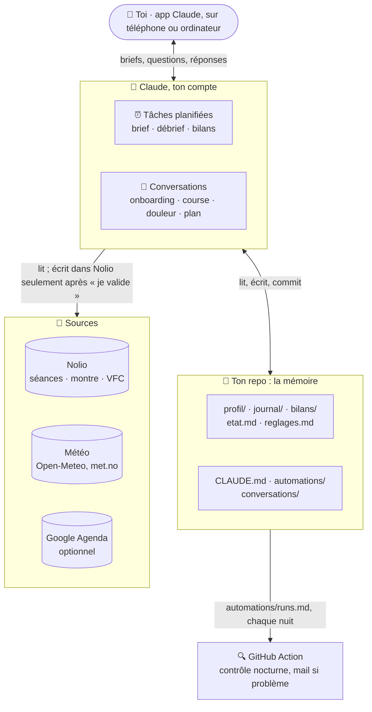
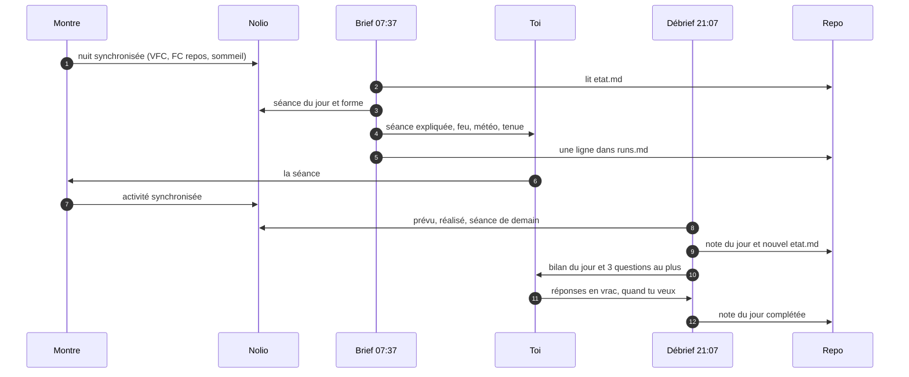
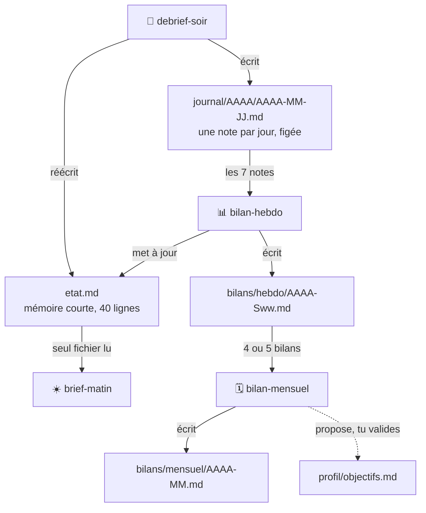
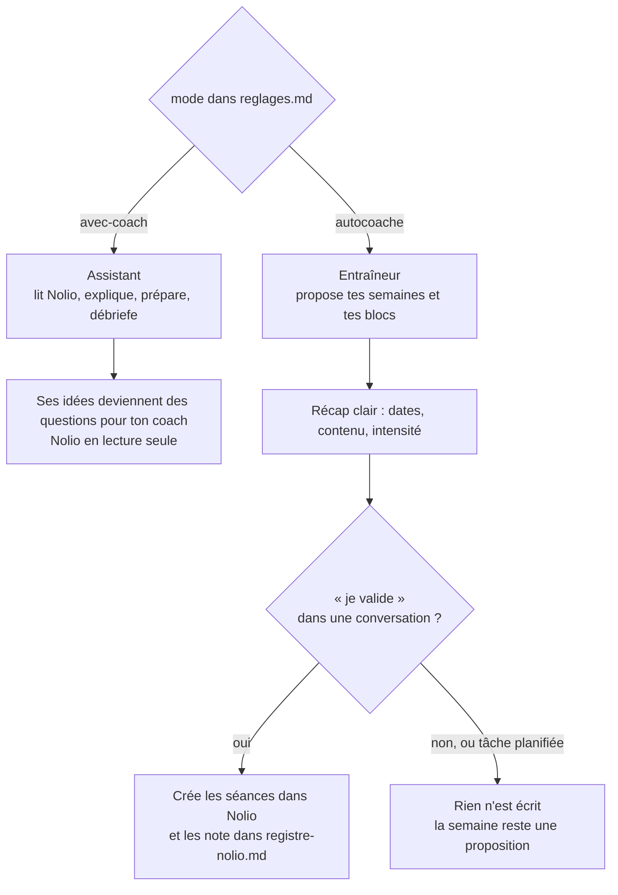
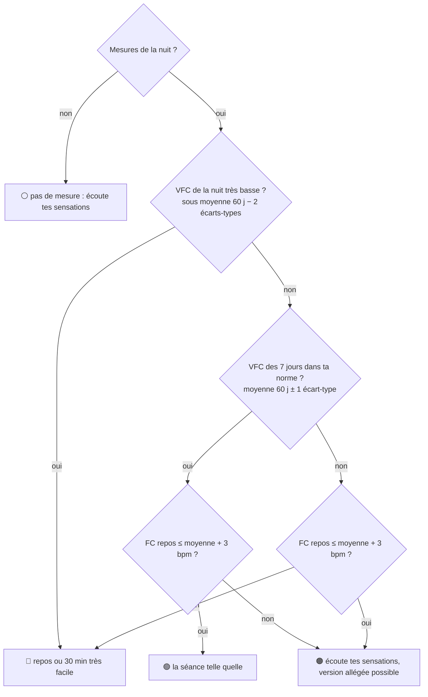
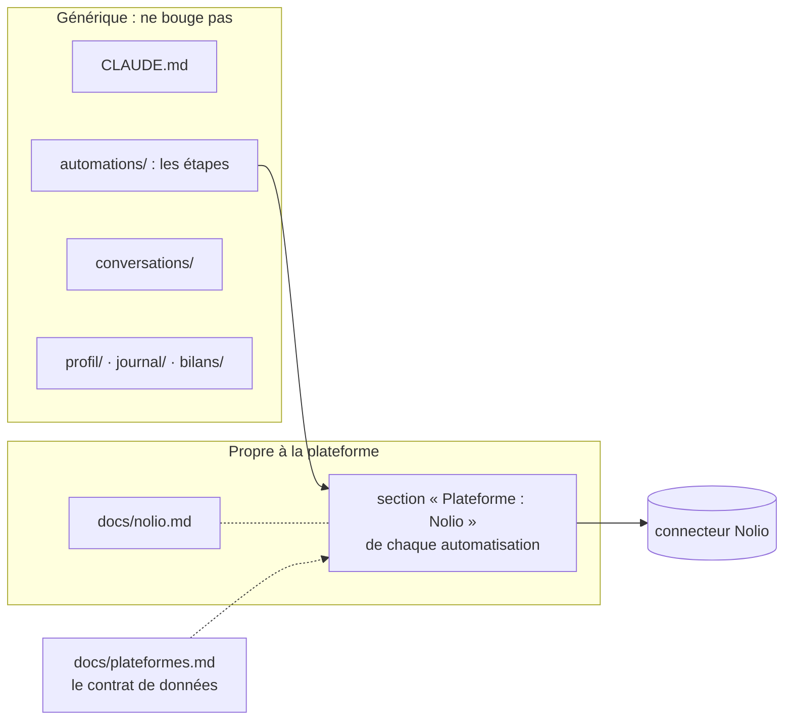
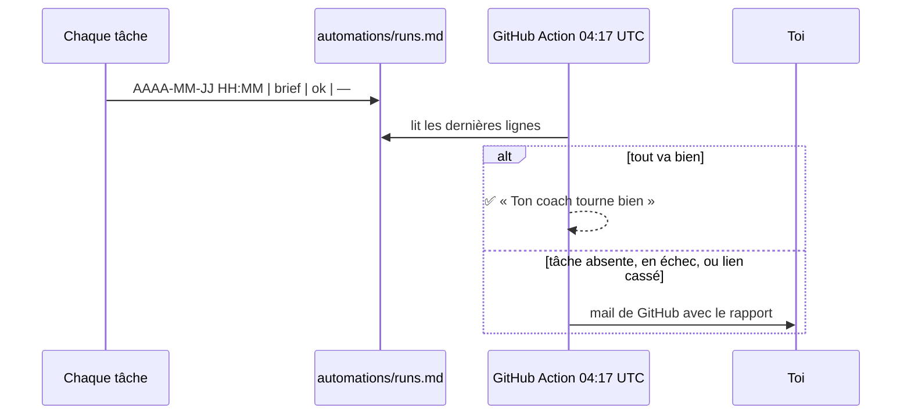

# Architecture — comment le coach fonctionne, en schémas

> **À quoi sert ce fichier :** comprendre le système d'un coup d'œil : qui parle à qui, ce qui se passe dans une journée, où vit la mémoire, et comment les deux modes protègent ton plan.
> **Mis à jour par :** contenu du projet.

## 1. Vue d'ensemble

Trois briques : **Claude** (le cerveau qui exécute), **ton repo GitHub** (la mémoire, en fichiers texte) et les **connecteurs** (Nolio pour les séances et la montre, la météo, l'agenda en option). Une GitHub Action surveille le tout chaque nuit.

## 2. Une journée

Le brief du matin ne lit **qu'un fichier** du repo (`etat.md`). Le débrief du soir écrit la note du jour et réécrit `etat.md` pour le lendemain. La boucle est bouclée.

## 3. La mémoire : qui lit quoi

Chaque niveau résume le précédent : le journal fait les bilans hebdo, les bilans hebdo font le bilan mensuel. Personne ne relit tout, et le coût reste constant au fil des mois.

## 4. Les deux modes

Le même coach, deux rôles. Avec un coach humain, il assiste et ne touche jamais au plan. En autocoaché, il entraîne, mais n'écrit qu'après ta validation, en conversation.

Trois verrous empilés :
1. **Les permissions Nolio** : lecture seule en mode avec coach, et jamais « modification ».
2. **La règle de `CLAUDE.md`** : jamais d'écriture pendant une tâche planifiée, et jamais sans récap ni « je valide ».
3. **Le registre** : le coach ne touche qu'aux séances qu'il a créées lui-même.

## 5. Le feu du matin

Ensuite : un sommeil sous 6 h décale d'un cran vers l'orange, et une alerte active (douleur, maladie) interdit le vert. Les règles complètes sont dans `automations/brief-matin.md`.

## 6. Générique contre propre à Nolio

Tout ce qui parle de Nolio est isolé. Brancher Garmin, Strava ou TrainingPeaks demain, c'est réécrire la partie de droite, sans toucher au reste.

## 7. Le contrôle nocturne

